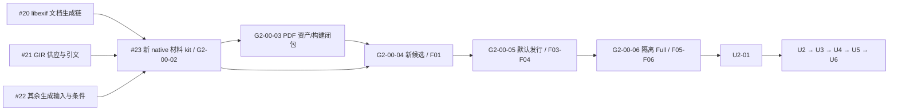

# only-my-pi 首批工单映射与依赖：2026-10-01

**2026-10-17 #22 工程收尾（当前材料状态）：** [#22](https://github.com/Ricardo121380/only-my-pi/issues/22) 已于北京时间 13:15:17 关闭并独立回读 CLOSED / completed，现行 10 条完成条件及[完成评论](https://github.com/Ricardo121380/only-my-pi/issues/22#issuecomment-6230047786)核对通过。入口 HEAD `fc7fdbd` 与[10 月 16 日验收](2026-10-16-generated-inputs-candidate-acceptance.md)最终回执一致；5 个执行相关文件、完整固定输入和双目录 10,359 文件/482,360,128 字节输出无漂移，按身份与范围复用原验证。[#21 交付与阻断](2026-10-15-gir-candidate-acceptance.md)继续 OPEN/PARTIAL、candidate admission BLOCKED，沿用“没有，保留阻断并交付已核实材料”的既定决定，未重跑。#23 仍 OPEN/BLOCKED、新 kit NOT_CREATED；三条依赖 #20/#21/#22 保留，当前 active blocked_by=1、total_blocked_by=3，唯一未完成前置为 #21。本次只收尾 #22，后续构建/Full 不推进，整体 licensing INCOMPLETE、G2-00-02/F02/F03 PARTIAL、Full NOT_RUN、U2 BLOCKED、产品历史 20/44 保持。详见[本次收尾与回读](2026-10-17-generated-inputs-engineering-closeout.md)；机器当前材料记录为 [materialCloseout20261017](2026-10-17-material-closeout-status.json)。下文各日期历史记录及旧发布 JSON 保留原身份。

**2026-10-14 本轮收尾：** #73、#74、#65 与 #75 均已回读 CLOSED / completed；各票证据分别见[生图](2026-10-11-pi110-images-acceptance.md)、[历史及导出](2026-10-11-pi110-image-history-acceptance.md)、[私有运行时](2026-10-13-pi110-private-runtime-acceptance.md)和[同候选整合验收](2026-10-13-pi110-integrated-acceptance.md)。#75 于 2026-10-13 北京时间 14:10:45 关闭，七条 AC、[完成评论](https://github.com/Ricardo121380/only-my-pi/issues/75#issuecomment-6139434444)与六条原生前置已核对；blocked_by=0、total_blocked_by=6，依赖边保留。GP110-08 的最终 C 全量为 1784 PASS / 0 FAIL / 0 CANCELLED / 8 SKIP，exit 0，原断言和超时不变、文件并发 2；同 N2 的 P 分段 23 项及资源补验 7 项、Ego Lite B 13+7 项与独立 Standards/Spec 复审分别 PASS。原 1763/9/10/7 全量 FAIL、19/19 隔离结果、并发 4 的后续失败及 Spec 首轮 PARTIAL 均保留原身份。#75 本地主仓工程收尾只提交入口基线后的归属增量，共改文件中的既有工作继续保留。#75 本地主仓收尾已提交 `d0f8989`，报告引用补正另为 `26ca9ae`。随后 [#20 libexif 新文档材料候选](https://github.com/Ricardo121380/only-my-pi/issues/20)于 2026-10-14 北京时间 00:24 回读 CLOSED / completed，九条 AC 与[完成评论](https://github.com/Ricardo121380/only-my-pi/issues/20#issuecomment-6150146305)匹配、历史正文/评论保留。[实际材料验收](2026-10-14-libexif-document-candidate-acceptance.md)覆盖固定输入/工具/配置、两个独立目录 5,803 对象全字节一致、106→111 逐项差异、双 Node、实际禁网及 26 项拒绝负例；双 Node 相关回归各 18 PASS，最终工程全量 1789 PASS / 0 FAIL / 0 CANCELLED / 8 SKIP，Standards 与 Spec 分别 PASS。本轮止于 #20。#23 的三条依赖边保留，blocked_by=2、total_blocked_by=3。#21/#22 仍 PARTIAL、#23 BLOCKED；#19、后续 G2、Full、真实服务、GP110-09 与日常晋升继续按各自门禁，产品历史 20/44 不变。下文有日期的批次与发布记录保留历史含义，#75 候选机器状态见[实施快照](2026-10-13-pi110-status.json)，#20 当前结果以本段材料验收为准，原发布 JSON 保留原字节。

**2026-10-11 分类批次历史映射：** 新增 Pi 1.1.0 路线见[实际工单映射](2026-10-10-pi-1.1.0-ticket-review.md)。#70 / PI110-N09、#71 / PI110-N10 与 #72 / PI110-N11 已完成并回读 CLOSED / completed；#72 分类绑定、预算及请求账本的必需 C/P/B、Standards/Spec 和回归见[分类验收](2026-10-11-pi110-classification-acceptance.md)。本批在 #72 结束；下一项 #73 图片生成，随后 #74 图片产物，两票保持 OPEN、未实施。#19 和 GP110-07 整体保持未完成。下列材料与发布快照保留原身份和门槛，原产品 20/44 不代表扩大后项目完成率。

状态：**2026-10-09 剩余任务 to-spec → to-tickets 已完成发布。[总规格 #19](https://github.com/Ricardo121380/only-my-pi/issues/19)保留；既有 #20–#23 继续跟踪材料；新增 #24–#61 共 38 张已发布并回读正文、标签及原生依赖。#20–#22 仍 PARTIAL，#23 仍 BLOCKED，产品 20/44。** [完整已发布工单与实际映射](2026-10-09-remaining-ticket-review.md)包含全部 42 张剩余实施工单。首批 01–04 对应 #20–#23；G2-N/U2-N–U6-N 是稳定跟踪编号，实际 Issue 号见映射。选定 tracker 为 [GitHub Issues](https://github.com/Ricardo121380/only-my-pi/issues)。

[当前基线](2026-10-01-engineering-baseline.md)保留原 232 文件工作树；[机器可读任务映射](2026-10-01-engineering-ticket-plan.json)逐项保留 44 产品 Task 的原状态/依赖与 6 个 G2 内部步骤。G2 子工单不增加产品 Task 分母。

第 0–11 节保留 2026-10-01 至 10-07 的历史流程、首批映射与观察时点；第 12 节保留本轮批准前的拆分快照。当前发布结果和全部原 Task 的实际 Issue 映射以第 13 节及最新机器映射 `remainingWorkWorkflow1009` 为准。

## 0. 本轮流程纠偏与讨论状态

本轮配置与基线整理后曾先行拆分；经用户指出，已补做本次 grill-with-docs，Q1–Q4 全部确认，to-spec 已综合并发布总规格。2026-09-26 的 Q1–Q23、R1–R3 历史决定和既有验收保留为基线；不能据此跳过本次规格范围、成功标准和测试边界的核对。

当前流程：grill-with-docs 分轮讨论与共同理解确认 → to-spec 综合已有结论与已确认测试边界、发布总规格 → to-tickets 对照规格重审拆分与依赖 → 实施与验收。明确下来的领域术语及时记入 CONTEXT，真实且难逆的架构取舍才记录 ADR。

第一轮已确认。用户答复：“两个问题都按照推荐的来”。

| 决策 | 用户确认的结果 | 状态 |
| --- | --- | --- |
| Q1：本次规格覆盖范围 | 剩余 WebUI 路线：G2-00 与 U2–U6；以已验收的 S0/U0/U1 为基线，再确定首份规格边界 | CONFIRMED |
| Q2：本次梳理的首要成功结果 | 需求、工单与验收证据对应，每次开发有明确目标和完成标准 | CONFIRMED |

第二轮 Q3 已确认。用户选择：“一份总规格，工单逐批细化（推荐）”。总规格覆盖 G2-00 与 U2–U6 的全部功能范围、阶段依赖和验收标准；首批细化当前 G2-00-02，后续批次进入前再细化对应工单。第三轮完成入口静态核对后，用户选择“确认共识与测试边界，进入 to-spec（推荐）”。Q4 与共同理解已确认，规格综合及发布已获本轮明确授权。

旧计划的产品范围、阶段顺序及分层验收继续作为输入；本轮优先补齐需求 → 规格条目 → 工单/原 Task → Gate → 源码与证据 → 状态的对应关系。这里描述工作追踪，未新增产品功能或领域术语。

四张拆分已按[总规格 #19](https://github.com/Ricardo121380/only-my-pi/issues/19)及[本地规格副本](2026-10-01-webui-remaining-spec.md)复核范围、粒度、阻断和验收。2026-10-02 用户对 Q5 明确答复“按四张拆分发布”；to-tickets 的拆分审阅与发布均已完成。此次初始发布时尚未认领或开始实施；10-02 后续实施状态见本文第 9 节。

### 第三轮 Q4：测试边界与共同理解，已确认

已确认的共同理解：剩余 WebUI 路线为范围，以 S0/U0/U1 为历史基线；首要成功结果是需求、工单、验收证据可对应；一份总规格覆盖 G2-00 与 U2–U6，先细化 G2-00-02，后续工单逐批细化。现有功能范围、阶段门禁及其各自证据要求沿原计划保留。

用户已确认以下测试边界：

| 验证行为 | 优先复用的外部入口 | 断言和证据 |
| --- | --- | --- |
| Host 业务与 Pi 协议 | Host HTTP/WebSocket；固定 Pi 真实进程与 loopback Provider 的既有集成夹具 | 请求/事件、准入与错误、可回读的状态/历史、实际 Pi 请求和消费关联；HTTP 模拟 Worker 与真实 Pi 分列 |
| WebUI 用户旅程 | Ego Lite 操作连接实际 Host 的页面 | 可见操作结果、保存/刷新/失败/恢复、真实输入和页面一致性；组件模拟只补机制与边界 |
| 材料、发行与安装 | 固定材料探针 CLI；当前候选的默认 staging 和隔离 Full 安装接口 | 输入到材料/产物的身份与完整性、缺输入/漂移拒绝、断网安装后从包内资源运行、回滚与重新应用 |

偏好在最高可行入口断言外部行为，复用现有夹具；局部单元测试用于必要边界/异常，不以私有 helper 调用次数或内部文件布局代替验收。每条规格验收映射原 Gate 与所需 C/P/B/I/L，真实外部 Provider 继续使用原定单独授权包。

本轮是静态核对，依据及限制：

- [Host HTTP 先例](../../tests/host-input-http.test.mjs)第 15–38 行通过生产 startHost、HTTP 和事件观察行为；提交场景第 49–66 行注入 Worker，不能当真实 Pi。
- [真实 Pi 集成先例](../../tests/host-input-rpc.test.mjs)第 23–61 行绑定 Pi 0.85.1、本地 SSE Provider 与实际 spawn；该入口绕过 HTTP。
- [浏览器夹具](../../tests/fixtures/host-input-browser.mjs)第 96–105 行使用实际 Host/RpcWorker 与公开命令；[组件测试](../evidence/2026-10-18-local-development-history.md#local-f2a5fca51c9ff18b)包含 inputApi 模拟，二者证明范围分别记录。
- [stager 测试](../../tests/release-payload-stager.test.mjs)第 54–64 行注入 prepare 并创建空 payload 目录；成功不能证明默认 parser 打包接线。
- [现有隔离安装脚本](../../scripts/phase1-stack-rehearsal.mjs)第 10–25、63–74 行绑定输入 Full manifest、Pi 0.85.1/Node 24.19.0，并提供安装/回滚/重新应用参考；只含版本/RPC 冒烟，不能替代新 parser 完整矩阵。
- [旧 M11 脚本](../../scripts/m11-protected-release-acceptance.mjs)第 37、235 行固定旧 release 与 Pi 0.84.3；不能直接作为当前候选验收命令。[U0 离线探针](../evidence/2026-10-18-local-development-history.md#local-30af436d2533866e)第 47 行也明确不提供生产 Full 安装结论。

本轮未执行上述产品测试、构建或安装。共同理解与测试入口已确认；[总规格](2026-10-01-webui-remaining-spec.md)包含 81 条用户故事和全部阶段/Gate 对应，已发布为 [总规格 #19](https://github.com/Ricardo121380/only-my-pi/issues/19)，远程正文与本地文件一致。Q5 已在 2026-10-02 确认；四张工单发布及原生依赖回读均完成。

## 1. 首批四张已发布工单

| 本地正文 | 原 Task | 标题 | 规格需求 | 完成前置 | 独立可核验产物 | GitHub Issue |
| --- | --- | --- | --- | --- | --- | --- |
| [01](2026-10-01-engineering-ticket-drafts/01-libexif-css-graphviz.md) | G2-00-02 | 闭合 libexif 文档生成链的剩余材料 | US-006/007/010 | 无本批工单前置 | 固定 CSS/图/剩余生成数据的来源、输入、转换与分发记录，可离线复核 | [#20](https://github.com/Ricardo121380/only-my-pi/issues/20) |
| [02](2026-10-01-engineering-ticket-drafts/02-gir-supply-and-quotes.md) | G2-00-02 | 闭合 GIR 供应与加工链及手册引文 | US-008 | 无本批工单前置 | 固定 GIR 的逐项供应版本、转换链与引文材料，可离线复核 | [#21](https://github.com/Ricardo121380/only-my-pi/issues/21) |
| [03](2026-10-01-engineering-ticket-drafts/03-generated-input-obligations.md) | G2-00-02 | 闭合其余生成输入及工具分发条件 | US-009/010 | 无本批工单前置 | 剩余 8 输入和宏/脚本的固定工具输入、生成对应与条件台账 | [#22](https://github.com/Ricardo121380/only-my-pi/issues/22) |
| [04](2026-10-01-engineering-ticket-drafts/04-new-native-material-kit.md) | G2-00-02 | 汇总并核验新的完整 native 材料 kit | US-005/010/011 | 01、02、03 完成 | 新 kit、全文件清单、完整输入/义务对账和 G2-00-02 出口报告 | [#23](https://github.com/Ricardo121380/only-my-pi/issues/23) |

每张都从固定输入取证到可复验结果，不按“先 Schema、再 API、再 UI”拆层。01–03 互不把对方结果作为必要输入，可分别取证；共享输入仅只读，输出使用各自独立目录。04 必须等三个材料域收口后才能确认完整新 kit。

完成某张材料工单只证明其声明范围；不能将材料子集 PASS 自动升级为 G2-00、Full 或 U2 放行。无法取得对应材料或满足条件时记录 BLOCKED/PARTIAL，工单仍未满足关闭条件。

## 2. 已发布依赖与可执行前沿

当前依赖图中无本批工单前置的项为 [#20](https://github.com/Ricardo121380/only-my-pi/issues/20)、[#21](https://github.com/Ricardo121380/only-my-pi/issues/21)、[#22](https://github.com/Ricardo121380/only-my-pi/issues/22)，三项均已开始实施且完成状态为 PARTIAL。[#23](https://github.com/Ricardo121380/only-my-pi/issues/23) 的原生 blocked-by 与正文仍指向前三项，当前 BLOCKED、新 kit 未生成。四项保持 OPEN，远程仍未认领。[新候选定向讨论与增量规格](2026-10-02-material-candidate-discussion.md)已获 R1–R4 确认并发布，下一步从 #20 剩余生成缺口继续；ready-for-agent 标签不替代这些材料缺口或依赖条件。

G2-00-05 的隔离接线设计/夹具准备可以在前置完整验收前进行；图中依赖约束正式启用和完成验收，不把所有准备工作人为串行化。图不改变原完整材料/身份/元数据/Full 的门禁。

## 3. 原 G2 内部步骤的迁移关系

| 原 ID | 当前记录 | 本批映射 | 后续完成依赖 |
| --- | --- | --- | --- |
| G2-00-01 | 固定重建输入技术子集已验收 | 历史证据，不创建未完成 Issue | 保留原证据和未被豁免的总门禁 |
| G2-00-02 | 材料收口 PARTIAL | #20–#23，工作状态由对应 Issue 跟踪 | 04 满足出口后才记本内部项完成；总体 F02 仍需 PDF 等闭包 |
| G2-00-03 | 待开始 | 本批不创建 | G2-00-02 完成 |
| G2-00-04 | 待前两项 | 本批不创建 | G2-00-02、G2-00-03 |
| G2-00-05 | 待 F02、候选身份 | 本批不创建 | 正式完成前须 G2-00-02/03/04；隔离准备可先行 |
| G2-00-06 | 待 F01–F04 | 本批不创建 | 固定输入、新候选、默认接线、元数据全部闭合；完整 F05/F06 PASS 才放行 U2 |

原内部步骤范围与状态来自[固定重建输入/内部顺序](2026-09-30-webui-g2-00-rebuild-inputs-progress.md)、[native 源码进展](2026-09-30-webui-g2-00-native-source-progress.md)及[Full 实施清单](2026-09-29-webui-u0-parser-full-integration.md)。

## 4. 全部 44 产品 Task 的映射

以下只是产品 Task 的迁移定位。总规格与 G2-00-02 的四个材料子工单已发布；44 个产品 Task 本身尚未逐项迁移，其工作状态仍以原看板为准。已有验收是历史状态，本轮未重验。

| 批次 | 原 Task ID | 原记录/迁移处置 | GitHub Issue |
| --- | --- | --- | --- |
| S0 | S0-01、S0-02、S0-03、S0-04、S0-05、S0-06、S0-07、S0-08 | 已验收，保留历史，不新建未完成任务 | 未迁移 |
| U0 | U0-01、U0-02、U0-03、U0-04、U0-05、U0-06 | 技术可行性已验收，保留历史 | 未迁移 |
| U1 | U1-01、U1-02、U1-03、U1-04、U1-05、U1-06 | C/P/B 已验收，保留历史 | 未迁移 |
| U2 | U2-01、U2-02、U2-03、U2-04、U2-05、U2-06 | 待开始，整体入口被 G2-00 阻断 | 未迁移 |
| U3 | U3-01、U3-02、U3-03、U3-04 | 待 U2，沿原细项依赖 | 未迁移 |
| U4 | U4-01、U4-02、U4-03、U4-04 | 待 U3，沿原细项依赖 | 未迁移 |
| U5 | U5-01、U5-02、U5-03、U5-04、U5-05 | 待 U4 及 U0 预览前置，沿原细项依赖 | 未迁移 |
| U6 | U6-01、U6-02、U6-03、U6-04、U6-05 | 待产品整合；Provider 与日常晋升保留专门授权门槛 | 未迁移 |

总计：历史已验收 20，待推进 24，合计 44。机器映射存储每一个 ID、原文状态和原文依赖；G2-00-02 的四张工单是一对多拆分，不重编号或重置原产品 Task。

## 5. 工单来源与完成口径

共同依据：

- [总规格 #19](https://github.com/Ricardo121380/only-my-pi/issues/19)及[本地规格](2026-10-01-webui-remaining-spec.md)：本轮已确认需求、测试边界与需求 → Task → Gate 映射。
- [完整优化计划](2026-09-26-webui-optimization-plan.md)、[Task 看板](2026-09-26-webui-optimization-tasks.md)、[验收矩阵](2026-09-26-webui-optimization-acceptance.md)。
- [ADR-0017：版本化运行时合同与 stack 晋升](../decisions/ADR-0017-versioned-runtime-contracts-and-stack-promotion.md)。
- [locale 技术子集](2026-10-01-webui-g2-00-locale-adapter-acceptance.md)、[Windows/供应材料](2026-10-01-webui-g2-00-cross-platform-materials.md)、[已绑定生成材料](2026-10-01-webui-g2-00-generated-materials.md)均保留历史身份。

逐工单依据：

| 本批编号 | 原始来源 | 本轮定位到的剩余项 |
| --- | --- | --- |
| 01 | [libexif 材料报告](2026-10-01-webui-g2-00-libexif-doc-materials.md)，第 48–51、86 行 | CSS 组合/历史配置、Graphviz 来源与图输入、剩余生成数据及分发条件 |
| 02 | [cross-platform 材料报告](2026-10-01-webui-g2-00-cross-platform-materials.md)与[native 范围复核](2026-10-01-webui-g2-00-native-closure-review.md) | 53 固定文件/40 GIR 的原供应版本、加工链与原手册引文；不将仓库 MIT 扩张到输入来源 |
| 03 | [notice 清单](2026-10-01-webui-g2-00-notice-inventory.md)，第 20–59 行 | 111 宏/脚本的来源及实际条件；12 输入中 3 内容对应保留，libexif 归 01，其余 8 输入待闭合 |
| 04 | [native 源码进展](2026-09-30-webui-g2-00-native-source-progress.md)、[内部顺序](2026-09-30-webui-g2-00-rebuild-inputs-progress.md)、01–03 的新证据 | 新 kit 身份、完整集合核验、原输入保护，以及 native 材料范围的总出口 |

工单正文使用领域目标和可核验完成条件，不固定实现文件路径。具体文件、历史回执和源码摘要由本映射及基线记录维护。

材料工单默认要求相关 C/静态合同检查，以及实际有界本地离线材料探针。P/B/I/L 不自动成为材料工单的通过条件；到对应阶段再由原验收矩阵约束。Full、安装、收费 Provider、日常晋升不能从材料完成推导出授权或 PASS。

## 6. 初次发布状态与当时的下一步

- Q1–Q4 确认总规格及测试边界，Q5 于 2026-10-02 确认“按四张拆分发布”；总规格 #19 与工单 #20–#23 均已发布，标签为 ready-for-agent。
- 四张正文保留获批范围、全部验收条件、US 编号和 F02 native 材料出口边界，发布后按正文、标题、标签、状态回读。
- #23 的三条 GitHub 原生依赖为 #20/#21/#22，正文包含对应链接；#20/#21/#22 无原生阻断。当前四项均未认领，下一项建议 #20。
- 仅 G2-00-02 子工单的工作状态迁移到对应 Issue；原看板补充映射与批次汇总，44 产品 Task 原状态/依赖保持。未认领、关闭或重开条目，未修改总规格 #19 的正文、标题、状态或标签。
- 近期本地计划、ADR 和基线提交仍未推送；公开正文使用总规格稳定链接和报告标题/日期，具体本地出处由本映射保留，不制造远程文件链接。
- 其他三个缺少的默认 triage 标签暂未创建。本轮无需新增标签、发布软件、执行 native 构建、Full 安装、付费调用或日常晋升。

ready-for-agent 表示需求及测试设计明确；#23 仍受依赖阻断。工单发布不增加产品验收数，G2-00-02 PARTIAL、U2 BLOCKED、20/44 保持。

## 7. 2026-10-01 规格核验记录

- 两项独立只读核验覆盖 U2–U6 产品/验收合同和 G2 材料/发行约束；主代理抽核原文后补回五项：F05 干净源码与空间条件；兼容 overlay、重新配置及 locked/offline；上传请求和类型边界；清理后不可用标记；预览两种主机访问路径及伪造 Host 请求头负例。
- 规格七个指定章节完整，81 条用户故事，30 个原 Task 对应（G2 六步骤加 U2–U6 二十四项），25 个完整剩余 Gate，原必需证据层保留。
- 文档链接检查 2/2 PASS；232 个原工作树文件和四份配置的字节/权限一致，原 tracked diff 摘要一致，index 为空。
- 这些都是静态文档/映射核验与远程发布回读；本轮产品运行、native 应用构建、Full、真实 Provider、日常晋升均 NOT_RUN。

## 8. 2026-10-02 工单发布记录

| 本批编号 | GitHub Issue | US | 原生 blocked-by | 发布回读 |
| --- | --- | --- | --- | --- |
| 01 | [#20](https://github.com/Ricardo121380/only-my-pi/issues/20) | US-006/007/010 | 无 | 正文/标题/标签一致，OPEN、未认领 |
| 02 | [#21](https://github.com/Ricardo121380/only-my-pi/issues/21) | US-008 | 无 | 正文/标题/标签一致，OPEN、未认领 |
| 03 | [#22](https://github.com/Ricardo121380/only-my-pi/issues/22) | US-009/010 | 无 | 正文/标题/标签一致，OPEN、未认领 |
| 04 | [#23](https://github.com/Ricardo121380/only-my-pi/issues/23) | US-005/010/011 | #20、#21、#22 | 正文/标题/标签与三条依赖一致，OPEN、未认领 |

本次在原 Task 看板的“当前具体下一步”中只增加 Issue 导航段落；旧内容和全部 Task 行保留。其余原 231 个工作树文件、四份配置及原始基线清单应保持字节/权限不变。原 232 文件快照继续作为 2026-10-01 历史基线，不重写其摘要。最终静态校验结果记录于机器映射的 publicationVerification；本次不新增产品运行或材料验收证据。

## 9. 2026-10-02 实施状态同步与新候选讨论

[实施事实与定向讨论](2026-10-02-material-candidate-discussion.md)记录最新本地 HEAD `0f258c90`：#20 的 `c9b756e`、#21 的 `9e0497c`、#22 的 `f4cc764` 已交付部分实现和本地验证，三项均 PARTIAL；#23 的前置报告已提交，新 kit NOT_CREATED，工单 BLOCKED。历史发布记录保留，机器映射的 implementationStarted 已更新为 true。

用户已确认优先保持组件版本、对缺失材料采用新可复现候选，允许新旧生成字节不同且保留差异/历史。材料关闭条件与新生成测试设计及具体成稿均已确认；总规格 #19 和 #20–#23 的五份正文已替换为获批稿并回读一致，沿用原四张切片，不重开已验收产品任务。

本次状态核对与文档同步不新增运行证据；G2-00-02/F02/F03 PARTIAL、完整材料/许可 INCOMPLETE、Full NOT_RUN、U2 BLOCKED、20/44 保持。远程进展同步结果记录在机器映射 implementationStatus。

## 10. 2026-10-02 增量规格与工单发布

R4/Q4 用户批注“确认”后，按获批的五份完整正文更新既有 #19–#23；正文/本地副本/冻结审阅稿 5/5 一致。原标题、OPEN 状态、ready-for-agent 标签、负责人及评论保持；#23 的原生 blocked-by 回读为 #20/#21/#22，三项均 OPEN。

验收对象改为新可复现材料候选，历史候选及失败保留；当前复制/生成条件在材料阶段满足，后续构建/最终包分发/Full 义务分别交接到 G2-00-04/05/06。实际两次独立生成、完整字节比对、旧新差异/兼容、双 Node 和真实禁网负例成为新生成部分的必需证据。

下一实施入口为 #20；#21/#22 可在各自明确范围内继续，#23 仍等待前三项材料出口全部满足。产品仍 20/44，材料工单的原 PARTIAL/BLOCKED 状态不因规格修订而升级。确认与静态/发布记录见[本轮讨论](2026-10-02-material-candidate-discussion.md)和机器映射 incrementalRevision。

## 11. 2026-10-07 剩余工作 to-spec 综合与发布

用户在完成情况核对后明确要求“将剩下待完成内容进行 tospec”。本次沿用原 Q1–Q5 和材料 R1–R4 已确认的范围、阶段条件及测试边界，更新同一总规格 #19；没有新增待确认问题或测试入口。当前源码 HEAD 仍为 `0f258c90e90311a2e539fd3a276ad26c32749216`，保留已有工作树。

- [本地总规格](2026-10-01-webui-remaining-spec.md)保留 7 个模板章节、81 条原用户故事及 25 个 Gate 的必需证据层；原 30 条 Task→US→Gate 对应完整保留，并补齐逐项交付、完成前置和当前状态。
- 剩余范围明确为 G2-00-02–06 五个内部步骤及 U2–U6 二十四个产品 Task；G2-00-01 与 S0/U0/U1 保留历史验收。四张材料工单是一项 G2 内部步骤的拆分，不加入产品 Task 分母。
- #20–#23 的已交付子集与剩余结果已纳入总规格；其现行正文、标题、状态、标签、负责人和评论保持。#23 原生 blocked-by 回读仍为 #20/#21/#22。
- 产品范围/依赖与材料阶段条件两项独立只读核验均 PASS；这些结果仅证明文档一致性。#19 的发布正文、本地副本和冻结稿逐字节一致，仍 OPEN、ready-for-agent。
- 下一实施入口仍为 #20，#21/#22 可在独立范围内继续，#23 等待前三项全部满足关闭条件。产品 20/44、G2-00-02 PARTIAL、完整材料/许可 INCOMPLETE、Full NOT_RUN、U2 BLOCKED 保持；未产生新的运行验收、提交或推送。

本次发布回执（本机历史证据：`../../../artifacts/webui-optimization/remaining-spec-1007-a_65g83n/publication.json`）保存远程时间、正文摘要及依赖回读；[机器映射](2026-10-01-engineering-ticket-plan.json)的 remainingWorkSpecSynthesis 保存本次规格范围与核验结果。2026-10-02 的冻结稿和发布回执保留为历史，不覆盖其正文摘要。

## 12. 2026-10-09 全部剩余任务 to-spec → to-tickets

用户明确要求“把剩余任务/to-spec然后再/to-tickets”。本次先更新同一总规格 #19，保留 81 条需求、30 个原 Task 映射、25 个剩余 Gate 及原测试边界，再为 G2 后续和 U2–U6 全部剩余范围准备完整工单。当前源码为 `b09ef66184404426a8a33896a65082db024b3ce1`；新增提交只有 G2-N01 阻断报告，PDF 新候选 NOT_CREATED。原 249 个脏文件条目按准备时基线保护，规划文件的必要变更单独记录。

总规格已发布回读一致，正文 SHA-256 为 `e87eb4718089ef7f8142fdfc5610b672d2ccc3b57c8e31bddec10274bc05905c`。to-tickets 阶段保持父规格不变，沿用 #20–#23 的正文、进度和 #23 → #20/#21/#22 原生依赖。

| 范围 | 新拟工单数 | 对应原 Task |
| --- | --- | --- |
| G2 后续 | 5 | G2-00-03–06；G2-00-02 继续由已有四张跟踪 |
| U2 | 10 | U2-01–06 |
| U3 | 6 | U3-01–04 |
| U4 | 5 | U4-01–04 |
| U5 | 7 | U5-01–05 |
| U6 | 5 | U6-01–05 |

[编号列表与完整验收稿](2026-10-09-remaining-ticket-review.md)、[机器可读依赖与映射](2026-10-09-remaining-ticket-proposal.json)合计拟新增 38 张；加已有四张为 42 张剩余实施工单，不改变 44 个产品 Task 的分母。原 Task 须全部映射子项和 Gate 满足才迁移状态。10 月 7 日五张 G2 草稿保留原件并纳入本轮统一审阅，当前发布依据以新审阅稿为准。

本节记录的是批准前快照：当时为 DRAFT_REVIEW_REQUIRED，新增 Issue 数为 0；用户随后回复“确认”，发布结果见下一节。下一实施入口仍是 #20，#21/#22 可独立推进；#23 和后续 G2/U2 继续遵守前置。工单规划不新增产品验收、运行测试、Full、真实 Provider 或日常晋升证据。10 月 7 日 Node 全量的既有文档链接失败仍保留。

## 13. 2026-10-09 已批准的 38 张工单发布

用户回复“确认”后，按已审阅的粒度、验收要求与直接依赖发布 #24–#61；38/38 标题、正文、OPEN 状态和 ready-for-agent 标签回读一致，新增 47 条原生 blocked-by 回读一致。既有 #23 → #20/#21/#22 的 3 条边保留；所有新工单均未认领。父 #19 与现有四张工单的正文、标题、状态、标签、负责人及评论未改写。

| 原 Task | 实际 GitHub Issue |
| --- | --- |
| G2-00-02 | [#20](https://github.com/Ricardo121380/only-my-pi/issues/20)、[#21](https://github.com/Ricardo121380/only-my-pi/issues/21)、[#22](https://github.com/Ricardo121380/only-my-pi/issues/22)、[#23](https://github.com/Ricardo121380/only-my-pi/issues/23) |
| G2-00-03 | [G2-N01 / #24](https://github.com/Ricardo121380/only-my-pi/issues/24) |
| G2-00-04 | [G2-N02 / #25](https://github.com/Ricardo121380/only-my-pi/issues/25)、[G2-N03 / #26](https://github.com/Ricardo121380/only-my-pi/issues/26) |
| G2-00-05 | [G2-N04 / #27](https://github.com/Ricardo121380/only-my-pi/issues/27) |
| G2-00-06 | [G2-N05 / #28](https://github.com/Ricardo121380/only-my-pi/issues/28) |
| U2-01 | [U2-N01 / #29](https://github.com/Ricardo121380/only-my-pi/issues/29)、[U2-N02 / #30](https://github.com/Ricardo121380/only-my-pi/issues/30) |
| U2-02 | [U2-N03 / #31](https://github.com/Ricardo121380/only-my-pi/issues/31) |
| U2-03 | [U2-N04 / #32](https://github.com/Ricardo121380/only-my-pi/issues/32) |
| U2-04 | [U2-N05 / #33](https://github.com/Ricardo121380/only-my-pi/issues/33)、[U2-N06 / #34](https://github.com/Ricardo121380/only-my-pi/issues/34)、[U2-N07 / #35](https://github.com/Ricardo121380/only-my-pi/issues/35)、[U2-N08 / #36](https://github.com/Ricardo121380/only-my-pi/issues/36) |
| U2-05 | [U2-N09 / #37](https://github.com/Ricardo121380/only-my-pi/issues/37) |
| U2-06 | [U2-N10 / #38](https://github.com/Ricardo121380/only-my-pi/issues/38) |
| U3-01 | [U3-N01 / #39](https://github.com/Ricardo121380/only-my-pi/issues/39)、[U3-N02 / #40](https://github.com/Ricardo121380/only-my-pi/issues/40) |
| U3-02 | [U3-N03 / #41](https://github.com/Ricardo121380/only-my-pi/issues/41)、[U3-N04 / #42](https://github.com/Ricardo121380/only-my-pi/issues/42) |
| U3-03 | [U3-N05 / #43](https://github.com/Ricardo121380/only-my-pi/issues/43) |
| U3-04 | [U3-N06 / #44](https://github.com/Ricardo121380/only-my-pi/issues/44) |
| U4-01 | [U4-N01 / #45](https://github.com/Ricardo121380/only-my-pi/issues/45) |
| U4-02 | [U4-N02 / #46](https://github.com/Ricardo121380/only-my-pi/issues/46)、[U4-N03 / #47](https://github.com/Ricardo121380/only-my-pi/issues/47) |
| U4-03 | [U4-N04 / #48](https://github.com/Ricardo121380/only-my-pi/issues/48) |
| U4-04 | [U4-N05 / #49](https://github.com/Ricardo121380/only-my-pi/issues/49) |
| U5-01 | [U5-N01 / #50](https://github.com/Ricardo121380/only-my-pi/issues/50)、[U5-N02 / #51](https://github.com/Ricardo121380/only-my-pi/issues/51) |
| U5-02 | [U5-N02 / #51](https://github.com/Ricardo121380/only-my-pi/issues/51)、[U5-N03 / #52](https://github.com/Ricardo121380/only-my-pi/issues/52) |
| U5-03 | [U5-N04 / #53](https://github.com/Ricardo121380/only-my-pi/issues/53) |
| U5-04 | [U5-N05 / #54](https://github.com/Ricardo121380/only-my-pi/issues/54)、[U5-N06 / #55](https://github.com/Ricardo121380/only-my-pi/issues/55) |
| U5-05 | [U5-N07 / #56](https://github.com/Ricardo121380/only-my-pi/issues/56) |
| U6-01 | [U6-N01 / #57](https://github.com/Ricardo121380/only-my-pi/issues/57) |
| U6-02 | [U6-N02 / #58](https://github.com/Ricardo121380/only-my-pi/issues/58) |
| U6-03 | [U6-N03 / #59](https://github.com/Ricardo121380/only-my-pi/issues/59) |
| U6-04 | [U6-N04 / #60](https://github.com/Ricardo121380/only-my-pi/issues/60) |
| U6-05 | [U6-N05 / #61](https://github.com/Ricardo121380/only-my-pi/issues/61) |

完整工单正文、本地稳定编号、直接前置、交付与证据层见[已发布工单表](2026-10-09-remaining-ticket-review.md)，机器可读记录见[最新剩余方案](2026-10-09-remaining-ticket-proposal.json)。本轮只回填规划与追踪；原 44 个产品 Task 行及 20/44 历史验收不变，新的产品验收数为 0。

当前执行前沿是 #20/#21/#22，建议先继续 #20 的生成链缺口。#23 验收新 kit 后进入 #24（PDF 材料），随后 #25 native 实际构建 → #26 parser 运行矩阵 → #27 默认发行 → #28 隔离 Full；G2 出口满足后才进入 #29 起的 U2。材料、构建、发行、Full、产品、真实 Provider 和日常晋升证据继续分列，具体操作仍核对对应条件。

## 14. 2026-10-17 #22 工程收尾与当前材料映射

[本次收尾报告](2026-10-17-generated-inputs-engineering-closeout.md)将现行 #22 十条完成条件与[原候选验收](2026-10-16-generated-inputs-candidate-acceptance.md)逐项对应；原报告/回执的 OPEN 观察时点不改写。本次已更新 #22 正文勾选、追加[完成评论](https://github.com/Ricardo121380/only-my-pi/issues/22#issuecomment-6230047786)并按 completed 关闭，随后独立回读正文、全部评论、状态与原生依赖。实现 `2629b888087422ad4c99bdd46125e66d6f1caa5d` 和报告澄清 `fc7fdbd01cd414c9c3b49caba0b44b87a2764e0b` 尚未推送，未上传原始材料。

| Task / Issue | 当前状态 | 证据与范围 |
| --- | --- | --- |
| G2-00-02 / #20 | CLOSED（既有结果） | 沿用 [10 月 14 日验收](2026-10-14-libexif-document-candidate-acceptance.md)；本次 #23 依赖回读为 closed |
| G2-00-02 / #21 | OPEN / PARTIAL；candidate admission BLOCKED | [10 月 15 日交付与用户决定](2026-10-15-gir-candidate-acceptance.md)及[既有进展评论](https://github.com/Ricardo121380/only-my-pi/issues/21#issuecomment-5950149107)保留；未重跑、未改写远端 |
| G2-00-02 / #22 | CLOSED / completed；10/10 AC，PASS_MATERIAL_SLICE | [原验收](2026-10-16-generated-inputs-candidate-acceptance.md)、[本次独立回读](2026-10-17-generated-inputs-engineering-closeout.md)；材料阶段两轴各 0 findings，历史未知与整体许可边界保留 |
| G2-00-02 / #23 | OPEN / BLOCKED；kit NOT_CREATED | 三条既有边 #20/#21/#22 全保留，当前状态 closed/open/closed；active blocked_by=1、total_blocked_by=3，仍由 #21 阻断 |

[当前机器快照](2026-10-17-material-closeout-status.json)及旧机器映射新增的 `currentMaterialStatusRecord` 指向 `materialCloseout20261017`；该记录承接当前材料状态。旧顶层及 `remainingWorkWorkflow1009` 等对象按原观察日期完整保留，仍用于原 Task/Issue 发布映射，不作为今天的执行前沿。本次没有推进 #19、#23、后续构建、Full、U2 或日常晋升；不推荐自动重跑 #21。G2-00-02/F02/F03 PARTIAL、licensing INCOMPLETE、Full NOT_RUN、U2 BLOCKED 与产品 20/44 保持。
