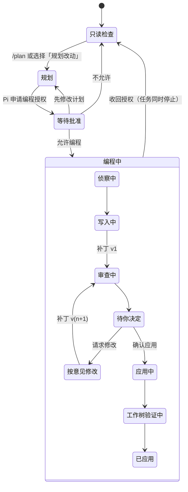

# Only My Pi 设计规范：静室

版本 0.1，2026-11-04。依据原型 B2「静室·编码」整理，适用于 Only My Pi 的 WebUI 与之后的桌面端。终端 CLI 只共用术语、状态与文案规则。

规范以原型代码为准：颜色变量在 [`src/index.css`](src/index.css) 的 `.proto-b` 与 `.proto-b.night`，组件在 [`src/prototypes/ReadingRoomCoder.tsx`](src/prototypes/ReadingRoomCoder.tsx) 与 [`src/prototypes/b2/`](src/prototypes/b2/)。运行原型后切到「规范」可以看到本文档的在线样张。

## 目录

1. [设计原则](#1-设计原则)
2. [颜色](#2-颜色)
3. [字体](#3-字体)
4. [布局](#4-布局)
5. [形状、层级与间距](#5-形状层级与间距)
6. [动效](#6-动效)
7. [图标](#7-图标)
8. [组件](#8-组件)
9. [交互模式](#9-交互模式)
10. [文案](#10-文案)
11. [无障碍](#11-无障碍)
12. [实现映射](#12-实现映射)
13. [尚未覆盖](#13-尚未覆盖)

---

## 1. 设计原则

**阅读在左，代码常驻在右。** 对话是一列安静的阅读文字；计划、补丁、文件和命令输出放在旁边可拖拽的工作区里，不用切页也能对照。

**决定必须由人明确做出。** 编程授权、模型选择、应用补丁、删除账号都需要一次明确的动作。界面可以高亮上次的选择，但不能替用户沿用。

**状态要说真话。** 账号有「可用、密钥被拒绝、登录已过期」，命令有「运行中、exit 0、已取消」，补丁有版本号。未知、已取消和失败要直接写出来，不能藏起来或伪装成成功。

**只在一处用力。** 每个画面只保留一个视觉重点：等待批准时是审批停靠栏，审查时是行内意见，其余元素保持低调。纸色、墨蓝和衬线正文就是全部风格，不另加渐变、光效或装饰插画。

**同一件事同一个名字。** 动作名从按钮一直延续到结果：「允许编程」对应「你允许了编程」，「应用到工作树」对应「已应用到工作树」。术语以 [第 10 节](#10-文案) 的词汇表为准。

---

## 2. 颜色

### 2.1 色板

日间是带一点橄榄绿的纸灰，配墨蓝；夜间用暖中性灰，避免偏蓝的黑。两套用同一组语义变量，组件里只写变量。

| 变量 | 日间 | 夜间 | 用途 |
| --- | --- | --- | --- |
| `--canvas` | `#e9ece6` | `#15171a` | 窗口底色、侧栏、状态栏 |
| `--background` | `#f4f5f1` | `#1b1e21` | 对话面板、设置页 |
| `--card` | `#fbfcf9` | `#202428` | 卡片、工作区、输入框 |
| `--popover` | `#fbfcf9` | `#23272b` | 菜单、命令面板、对话框 |
| `--foreground` | `#1e221d` | `#e3e6df` | 正文与标题 |
| `--muted-foreground` | `#5e655c` | `#99a095` | 说明、时间、次要信息 |
| `--secondary` | `#e6e9e2` | `#272c30` | 用户消息、选中行、次要按钮底 |
| `--muted` | `#eceee8` | `#23282c` | 工作记录展开区、系统提示 |
| `--line` / `--border` | `#d9ddd4` | `#30363b` | 分隔线、卡片描边、面板外圈 |
| `--input` | `#d3d8ce` | `#363d42` | 输入框描边 |
| `--primary` | `#2c4a7c` | `#9cb6e3` | 主操作、链接、焦点、选中 |
| `--primary-foreground` | `#f7f9fc` | `#121a28` | 主按钮上的文字 |
| `--coding-foreground` | `#ffffff` | `#0d2117` | 绿色确认按钮、完成步骤上的文字 |
| `--destructive-foreground` | `#ffffff` | `#2a0d09` | 删除按钮上的文字 |
| `--accent` | `#e3e9f2` | `#222d3c` | 文件链接底、选中文件、补丁区块 |
| `--accent-foreground` | `#2c4a7c` | `#b3c8ec` | 上述底色上的文字 |

### 2.2 状态色

状态色只表达状态，不做装饰。

| 变量 | 日间 | 夜间 | 含义 | 出现位置 |
| --- | --- | --- | --- | --- |
| `--inspect` | `#6b7568` | `#8f988b` | 只读检查，没有编程授权 | 状态点 |
| `--planning` | `#7a5306` | `#d8a64a` | 需要你决定：等待批准、待处理意见、账号需要处理、有未提交改动 | 停靠栏描边、徽标、警告 |
| `--coding` | `#276a48` | `#6cc596` | 授权生效、检查通过、已应用 | 状态点、通过标记、成功横幅 |
| `--destructive` | `#c8372d` | `#e8857a` | 删除、失败、被拒绝的输入 | 删除按钮、错误文字、diff 删除行 |
| `--primary` | 见上 | 见上 | 正在进行 | 运行中的转圈、进度条 |

规则：

- 浅色底上的着色统一用 `color-mix`，8% 到 15%（Tailwind 写作 `bg-planning/15`、`bg-coding/10`），文字仍用对应的全色。
- 同一行最多出现一种状态色。整块需要提醒时，用描边加浅底，例如审批停靠栏的 `border-planning/35`。
- 不用渐变。只有 diff 的增删行允许整行着色，增为 `coding/10`，删为 `destructive/10`。

### 2.3 对比度

下表是实测的 WCAG 对比度，正文要求 ≥ 4.5，图形与大字要求 ≥ 3。

| 组合 | 日间 | 夜间 |
| --- | --- | --- |
| 正文 / 面板 | 14.7 | 13.3 |
| 次要文字 / 卡片 | 5.8 | 5.8 |
| 次要文字 / 次要底 | 4.9 | 5.3 |
| 墨蓝 / 面板 | 8.1 | 8.1 |
| 主按钮文字 / 墨蓝 | 8.4 | 8.5 |
| 琥珀 / 15% 琥珀底（最暗的画布上） | 4.6 | 6.2 |
| 绿 / 12% 绿底 | 4.6 | 6.5 |

2026-11-04 起，日间的次要文字、琥珀和绿都调深过一档，用来满足上表。新增颜色前先算过对比度再用。

---

## 3. 字体

### 3.1 字族

| 角色 | 字体 | 用途 |
| --- | --- | --- |
| 界面 `--font-ui` | Inter Tight Variable | 按钮、标签、导航、表格、说明 |
| 阅读 `--font-reading` | Source Serif 4 Variable | Pi 的回复、计划文档、页面标题、输入框里的正文 |
| 等宽 | JetBrains Mono Variable | 文件路径、命令、模型名、diff、提交号 |

中文依靠系统字体回退（苹方、思源）。衬线字体只决定西文与数字的样式，所以中文段落的气质主要来自字号和行距。

### 3.2 字号

| 名称 | 字号 / 行距 | 字体与字重 | 用在哪里 |
| --- | --- | --- | --- |
| Display | 32–34px / 1.2 | 阅读体 600 | 首次配置、新会话标题 |
| H1 | 26–28px / 1.2 | 阅读体 600 | 设置页标题、计划文档标题 |
| H2 | 19–20px / 1.3 | 阅读体 600 | 对话框标题、设置侧栏「设置」 |
| Lead | 15.5px / 1.65 | 阅读体 400，次要色 | 页面导语、计划摘要 |
| Reading | `--read-size`（15 / 16.5 / 18px）/ 1.75 | 阅读体 400 | Pi 的回复、计划正文、输入框 |
| Body | 14–14.5px / 1.6 | 界面体 400–500 | 用户消息、卡片标题、列表项 |
| UI | 13–13.5px / 1.5 | 界面体 400–500 | 按钮、导航、表单 |
| Meta | 12–12.5px / 1.5 | 界面体 400，次要色 | 说明、时间、计数 |
| Caption | 11–11.5px | 界面体 400 | 徽标、状态栏 |
| Code | 11.5–13px / 1.65 | 等宽 400 | 路径、命令、diff |

规则：

- 阅读字号只用 `--read-size`，用户在「设置 → 外观」里调整，默认 16.5px。
- 数字一律 `tabular-nums`，包括计数、版本、费用、行号。
- 不用全大写，不在标题上方加小号眉标。强调靠字重和位置，不靠单独给某个词变色。
- 中文使用全角标点。列举用「，」或「、」，不用「·」连接元信息。

---

## 4. 布局

### 4.1 窗口结构

```text
┌────────┬──────────────────────────────┬─┬─────────────────────────────┐
│ 侧栏   │ 对话面板                      │↔│ 工作区                       │
│ 256/56 │  ┌ 会话头 48px ─────────────┐ │ │  ┌ 标签 48px ──────────────┐ │
│        │  │ 标题  状态胶囊       ⌘J │ │ │  │ 计划 改动 文件 终端   × │ │
│ 项目    │  ├──────────────────────────┤ │ │  ├────────────────────────┤ │
│ 会话    │  │  阅读列 max 660px，居中   │ │ │  │  内容随宽度变化          │ │
│        │  │                          │ │ │  │  (container query)      │ │
│        │  ├ 审批停靠栏（需要时出现）─┤ │ │  │                         │ │
│ 设置    │  └ 输入框 ─────────────────┘ │ │  └─────────────────────────┘ │
├────────┴──────────────────────────────┴─┴─────────────────────────────┤
│ 状态栏 28px：分支 未提交 授权状态 子代理 Token 费用 上下文 模型 Host       │
└──────────────────────────────────────────────────────────────────────┘
```

- 对话面板与工作区是画布上的两块浮起的面板：外边距 8px，用 1px 外圈加 25px 圆角，不用投影。
- 分隔条 6px 宽，中间有一根 40px 的把手，悬停变成墨蓝。默认左右各占 50%，最小 32% 和 30%。
- 新会话与首次对话时，工作区换成「项目概览」，默认占 42%。
- 设置页占据两块面板的位置，侧栏和状态栏保留。

### 4.2 宽度

| 区域 | 规则 |
| --- | --- |
| 阅读列 | 最大 660px，左右 28px 内边距 |
| 新会话首页 | 最大 640px，顶部留出 9vh |
| 设置内容 | 最大 760px |
| 首次配置 | 最大 980px，右侧 14rem 页边说明 |
| 用户消息 | 最大 88%，右对齐 |
| 计划文档 | 最大 760px，工作区 ≥ 620px 时右侧出现 10rem 页边批注列 |

### 4.3 断点

| 条件 | 变化 |
| --- | --- |
| 窗口 < 1280px | 侧栏默认收起为 56px 图标栏（⌘B 展开） |
| 窗口 < 900px | 工作区默认收起（⌘J 打开） |
| 窗口 < 768px | 侧栏隐藏 |
| 工作区 < 620px | 页边批注改为内联 |
| 工作区 < 560px | 改动与文件从左右分栏变为上下，文件列表最多 144px 高 |
| 设置 < 720px | 分类从左侧列表变为顶部可横滑的标签 |

工作区内部用 container query，跟随面板实际宽度，而不是窗口宽度。

---

## 5. 形状、层级与间距

### 5.1 圆角

基准 `--radius: 0.875rem`（14px）。

| 名称 | 尺寸 | 用在哪里 |
| --- | --- | --- |
| `rounded-full` | 胶囊 | 按钮、状态胶囊、徽标、模型选择 |
| `rounded-[22px]` | 22px | 输入框 |
| `rounded-2xl` | 25px | 面板、卡片、停靠栏、对话框、设置分组 |
| `rounded-xl` | 20px | 工作记录展开区、命令卡片、表单输入、行内意见 |
| `rounded-lg` | 14px | 列表行、标签按钮、文件条目 |

层级越外，圆角越大：面板 > 卡片 > 行。同一层只用一种圆角。

### 5.2 层级

| 层 | 做法 |
| --- | --- |
| 0 画布 | `--canvas`，无描边 |
| 1 面板 | `--background` 或 `--card`，`shadow-[0_0_0_1px_var(--line)]` 外圈 |
| 2 卡片 | `--card`，`border-line` 描边 |
| 3 浮起 | 输入框与停靠栏 `0 10px 30px -18px`，颜色取前景色的 35% |
| 4 弹出 | 菜单、命令面板、对话框使用 `--popover`，`0 16px 40px -20px` 投影 |

卡片悬停时只加一层很淡的投影 `0 6px 24px -14px`，不位移、不缩放。

### 5.3 间距

以 4px 为基本单位。常用值：面板内边距 16 / 20 / 28px，卡片 16px，列表行 8–12px 纵向，相邻消息 24px，设置分组之间 32px。

---

## 6. 动效

| 场景 | 动效 | 时长 |
| --- | --- | --- |
| 侧栏展开收起、工作区标签指示 | spring，无回弹 | 0.35–0.4s |
| 新的对话项、页面切换 | 透明度加 6–8px 上移 | 0.2–0.3s |
| 展开工作记录、账号行 | 高度从 0 到 auto | 默认 |
| 进行中的文字 | Shiny Text 扫光（Magic UI） | 2.4s 循环 |
| 运行中的子代理 | 进度条往返 | 1.6s 循环 |
| 拖动分隔条 | 无动效，跟手 | — |

规则：

- 动效只回应用户操作，或标出「正在进行」。不给每块内容加入场动画，不给卡片做悬停位移。
- 扫光和往返进度条只能用在真实运行中的东西上，完成后立刻停止。
- `prefers-reduced-motion` 时全部降为 0.01ms，数字计数器直接显示终值。

---

## 7. 图标

- 使用 Lucide，线条粗细保持默认。正文旁 14px（`size-3.5`），导航与按钮 16px（`size-4`）。
- 图标只辅助文字。工具栏上只有图标的按钮必须有 `aria-label` 和带快捷键的提示。
- 状态图标是固定的一套：转圈表示运行中（墨蓝）、对勾表示完成（绿）、虚线圆表示排队（次要色）、叉表示失败（红）、三角表示需要处理（琥珀）、锁表示没有授权或不可操作。

---

## 8. 组件

每个组件依次写目的、构成、状态和规则。文件名指原型里的实现位置。

### 8.1 侧栏　`Nav`

- **构成**：收起按钮、「Only My Pi」衬线斜体字标、项目切换器（项目名加分支）、新会话 ⌘N、搜索与命令 ⌘K、会话分组，最下方是设置 ⌘,。
- **会话分组**：刚刚开始、进行中、最近、已归档。已归档默认折叠，并显示数量。
- **会话徽标**：只读、待批准（琥珀）、运行中（墨蓝点）、待审查（accent）、已完成（绿勾）。当前会话的徽标跟随实时状态，不读存储的旧状态。
- **收起态**：56px，只剩图标，提示从右侧弹出。设置图标上的琥珀点表示有账号需要处理。

### 8.2 会话头与状态胶囊

48px 高，内容是标题、状态胶囊、工作区开关。胶囊里是一个状态点加文字，文字依次为：只读检查、等待批准、侦察中、写入中、审查中、待你决定、应用中、工作树验证中、已应用，未提交、已停止。

### 8.3 用户消息　`UserBubble`

右对齐，`--secondary` 底，圆角 25px，正文 14.5px。有两个变体：

- **即时补充**：上方小字「即时补充，等待下一个可接收的位置」，送达后改为「已在下一步读取」。等待期间正文降到 75% 不透明。
- **审查意见**：上方小字「审查意见，交给写入者」，正文用等宽字，按 `文件:行  意见` 逐行排列。

### 8.4 Pi 的回复　`ReadingProse`

衬线体，`--read-size`，行距 1.75，前景色 90%。行内代码有两种：

- 能对应到项目文件的，渲染成 accent 底加下划线的按钮，点击后在工作区「文件」里打开。
- 其他代码只用 `--muted` 底。

### 8.5 工作记录　`WorkRecord`

把一步里的思考和工具调用合成一行，例如「读了 3 个文件，搜索 1 次，思考 6s」，最多叠放 3 个工具图标，右侧显示总耗时。

- 运行中自动展开，摘要文字带扫光。
- 展开后每行是「动作、目标（等宽）、结果、状态图标」。读文件的行可以点开文件，命令的行跳到终端。

### 8.6 产物链接　`ArtifactLink`

用于计划、补丁 v*n*、已应用。构成是左侧图标块、标题、一行元信息，右侧写「在工作区查看」。已应用状态的图标块用绿色。

### 8.7 审批停靠栏与审批记录

- **停靠栏** `ApprovalDock`：只在等待批准时出现，位于输入框上方，用琥珀描边加琥珀色投影。标题固定为「允许 Pi 修改这个项目？」，说明写文件数、风险、有效范围（仅本进程，不提交不推送），并附「查看计划」。按钮依次是「允许编程」（主按钮）、「先修改计划」（描边）、「不允许」（文字按钮）。
- **记录** `ApprovalRecord`：对话里只留一行，左侧 2px 竖线，竖线颜色跟随状态。行尾可以「收回」或「重新询问」。
- 停靠栏不跟着对话滚动，决定做出之前一直可见。

### 8.8 子代理条　`AgentStrip`

`--muted` 底卡片。标题写「N 位助手正在工作」，右侧写名额和并发。每个子代理占一列，从上到下是进度条、状态图标加名称、当前任务或「等写入完成」。被取消的子代理，进度条变为红色 60%。

### 8.9 输入框　`Composer`

- **构成**：引用文件标签（可以移除）、衬线体正文框、底部工具行（@ 引用、/ 命令、账号模型选择、发送）。
- **弹出列表**：输入 `@` 或 `/` 时在输入框上方弹出，按 Enter 选中第一项。
- **运行中**：发送键换成三种操作：「补充」（主按钮，Enter）、「排队」（描边）、停止（方形图标）。
- **排队消息**：显示在输入框上方的灰条里，写「排队 n」。任务运行中写「当前任务结束后可发送」，结束后出现「发送」，永远不自动发送。
- **占位文字**：随状态变化，三种状态各有固定文案，详见 [第 10 节](#10-文案)。

### 8.10 工作区　`Workspace`

- **标签**：计划、改动、文件、终端。选中的标签有 spring 滑块。徽标显示文件数、命令数，或「n 条意见」（琥珀）。
- **跟随工作**：等待批准时切到「计划」，开始编程切到「改动」。之后用户手动切换的选择要被保留。

### 8.11 计划文档

- 衬线体标题 26px，导语 15.5px。每一步之间用分隔线隔开，序号用等宽数字。
- 风险写在右侧页边的批注里：琥珀竖线、风险标识和一句话说明。
- 文档底部列出申请修改的文件（可点开）和批准的验证命令。

### 8.12 改动审查

- **验证进度条**：四步依次是克隆检查 → 范围与漂移 → 全新审查 → 工作树验证。完成的连线变绿。
- **文件列表**：每个文件左侧有「已查看」圆圈，点一下变成绿勾、文件名变淡。右侧显示意见数（琥珀）和增加行数。底部写「已查看 n / m」。
- **ReviewDiff**：行号是按钮，只在「待你决定」时可以点，悬停显示「+」。点开后在该行下方出现意见编辑框，⌘Enter 保存，Esc 取消。
- **意见卡片**：作者徽标为「审查者」（琥珀）或「你」（墨蓝）。已处理的划线并标「已处理」。自己写的意见在处理前可以删除。
- **底部操作**：「请求修改（n）」只在有未处理意见时可点；「应用到工作树」点下后，在原位置换成说明「将修改工作树中的 4 个文件」和「取消」「确认应用 v*n*」两个按钮。确认按钮是绿色，这是全界面唯一的绿色按钮。
- **已应用**：顶部出现绿色横幅「补丁 v*n* 已应用到工作树，验证通过。未暂存，未提交。」

### 8.13 文件与终端

- **文件**：左侧文件树，右侧显示面包屑和来源标注（工作树只读 / 受管克隆中的补丁 v*n* / 已应用补丁 v*n*）。
- **终端**：命令按「受管克隆」「工作树」分组，每条命令是一张卡片，头部写状态、命令、exit 码胶囊和耗时，正文是输出。运行中的命令末尾有闪烁光标；取消后写 `exit 130` 和「^C 已取消」。

### 8.14 状态栏

28px 高，画布底，11.5px 次要色，单行不换行。从左到右依次是：分支、未提交数（应用后变绿）、授权或阶段、子代理、Token、费用、上下文环、模型、本机 Host、重新演示、日夜切换。宽度不够时按以下顺序隐藏：模型 → Token 与费用 → 上下文 → 子代理。

### 8.15 命令面板　`Palette`

顶部 18% 处的对话框，宽 560px，分为会话、文件、操作、设置几组。支持上下键选择、Enter 执行、Esc 关闭。关闭后不把焦点还给触发按钮，避免 Enter 再次打开面板。

### 8.16 空状态　`Empty`

居中显示：40px 圆角图标块、14px 标题、14.5px 衬线说明（最多 20rem 宽）。说明要写清楚接下来会发生什么，例如「允许编程后，写入者在受管克隆中生成的补丁会出现在这里」。

### 8.17 设置

- **骨架**：左侧 208px 分类（窄屏变为顶部标签），右侧内容最大 760px。页面标题 28px 衬线，导语 15.5px，右上角放主操作。
- **分组 `Block`**：14px 半粗标题，下面一行说明，再下面是圆角 25px 的列表卡片。
- **账号行 `AccountRow`**：
  - 折叠时依次是状态点、名称、认证方式徽标、默认、使用中、一行状态说明；有问题时行尾直接给出修复按钮。
  - 展开后是 6rem 标签列，依次为默认模型、认证、本月用量、绑定的会话，最后是操作行。
- **确认区**：删除、停止引用等动作，在当前位置展开一个红色淡底的确认块，写清后果，按钮为「删除"名称"」或「取消」，不弹系统对话框。正在使用中的对象只显示原因和「知道了」。
- **问题汇总**：页面顶部的琥珀卡片列出需要处理的账号，点击可以定位到对应账号。

### 8.18 账号选择器　`AccountMenu`

- 按账号分组列出模型。不可用的账号只显示状态，并提供「去设置重新登录 / 更换密钥」，不能选中。
- 下方是思考强度，最后是「管理账号」。
- 新会话里，上次的选择以琥珀胶囊显示「上次用的是」加账号名和模型，胶囊里有「使用」「更换」两个按钮，必须确认后才能发送。

### 8.19 首次配置

- **页面**：顶部是字标和三步进度（步骤序号，完成后变成对勾），右上角「稍后再说」。底部是吸底操作栏，「继续」在条件满足前禁用，旁边写明还缺什么。
- **每一步**：左侧是标题、导语和表单；右侧 14rem 页边说明会吸顶，解释为什么要做这一步、数据存在哪里。

---

## 9. 交互模式

### 9.1 授权与任务阶段



- 授权只在当前进程内有效。恢复或继续会话时，只恢复历史，不恢复授权。
- 进入「编程中」以后，任何阶段都可以停止。运行中的子代理和命令标为已取消，结果未知的请求仍计入额度。

### 9.2 补丁应用

审查通过只表示可以应用。应用必须二次确认；应用后在真实工作树里重新运行批准的验证。整个过程不暂存、不提交。未提交数的变化会在状态栏显示出来。

### 9.3 补充与排队

| | 即时补充 | 排队消息 |
| --- | --- | --- |
| 何时生效 | Agent 下一个可接收的位置 | 当前任务结束后，由你手动发送 |
| 界面 | 对话里的用户消息，带「等待 / 已读取」状态 | 输入框上方的灰条 |
| 是否扩大授权 | 否 | 否 |

### 9.4 账号与模型

- 每个新会话都要确认一次模型，上次的选择只高亮。
- 会话绑定账号。账号失效时，任务停下来提示原因和修复入口，不会换成其他账号，也不会回退到 CLI 默认账号。
- 分类与生图各自绑定账号，在任务开始时固定。

### 9.5 破坏性操作

先说后果再给按钮，就地确认，不弹系统对话框。正在使用中的对象不允许删除，并说明怎样解除占用。

### 9.6 快捷键

| 键 | 作用 |
| --- | --- |
| ⌘K | 命令面板 |
| ⌘N | 新会话 |
| ⌘J | 打开或收起工作区 |
| ⌘B | 展开或收起侧栏 |
| ⌘, | 设置 |
| Enter / Shift+Enter | 发送（运行中为补充）/ 换行 |
| ⌘Enter / Esc | 保存 / 取消行内意见 |

---

## 10. 文案

### 10.1 语气

- 用「你」称呼用户，用「Pi」称呼 Agent。直接、平实，不寒暄，不道歉。
- 按钮用动词短语，写清点击后会发生什么：允许编程、应用到工作树、测试并保存、更换密钥。
- 状态写成事实：「补丁 v2 已通过全新审查」，不写「太棒了」。
- 出错时依次写三件事：发生了什么、可能的原因、怎么修。例如「DeepSeek 拒绝了这个密钥（401）。检查是否复制完整，或在服务商控制台重新生成后再试。」
- 空状态写接下来会怎样，不写「暂无数据」。
- 输入框的占位文字随状态变化，三种状态的写法如下：

| 状态 | 占位文字 |
| --- | --- |
| 等待批准时 | 可以先补充说明，Pi 会在下一个可接收的位置读取 |
| 运行中 | 补充说明会在下一步生效；也可以排到当前任务之后 |
| 平时 | 回复 Pi，@ 引用文件，/ 使用命令 |

### 10.2 词汇表

与项目的 `CONTEXT.md` 保持一致。

| 用这个词 | 意思 | 不要用 |
| --- | --- | --- |
| 只读检查 | 可以阅读和分析，不能修改 | 安全模式、只读沙箱 |
| 规划 | 只读地形成可审批的计划 | 计划模式 Agent |
| 编程授权 | 本进程在本项目内修改与验证的许可 | 权限、登录 |
| 受管克隆 | OMP 管理的普通 Git 克隆，写入者在其中工作 | 沙箱、副本 |
| 侦察者、写入者、审查者 | 只读子代理、唯一的写入子代理、全新上下文的审查子代理 | worker、bot |
| 补丁 v*n* | 写入者产出的改动，每次修改加一 | diff、PR |
| 工作树 | 你本机的真实项目目录 | 本地、仓库 |
| 即时补充 / 排队消息 | 见 9.3 | 中断、插队 |
| 产品账号 | 可以命名、显式选择的服务商身份 | 用户、凭证 |
| CLI 默认账号 | 终端 Pi 自己的账号，只读引用 | 导入的账号 |

### 10.3 格式

- 不用「A · B · C」，改用「，」或「、」。
- 不在链接或按钮后面加「→」。
- 数字与中文之间留一个空格（8 个、3 处未提交），数字与符号单位之间不留（$0.142、18.4s、38%）。
- 路径、命令、模型名一律用等宽字体，不翻译。

---

## 11. 无障碍

- 焦点环统一为 2px `--ring`，偏移 2px，对所有可交互元素生效。
- 可点击目标最小 28px，主要按钮 32px 以上。
- 语义：
  - 单选用 `role="radiogroup"` / `radio` 加 `aria-checked`。
  - 标签页用 `tablist` / `tab` 加 `aria-selected`。
  - 命令输出用 `role="log"`。
  - 检测结果用 `aria-live="polite"`，错误用 `role="alert"`。
  - 只有图标的按钮都要有 `aria-label`。
- 颜色从不单独表达状态，总有文字或图标同时说明。
- 尊重 `prefers-reduced-motion`。
- 密钥输入框用 `type="password"`、`autocomplete="off"`，并提供显示 / 隐藏切换。

---

## 12. 实现映射

| 规范项 | 代码 |
| --- | --- |
| 颜色、圆角基准、字族变量 | `src/index.css` 的 `.proto-b`、`.proto-b.night`，以及 `@theme inline` 映射 |
| Tailwind 语义类 | `bg-canvas`、`bg-card`、`text-muted-foreground`、`text-planning`、`bg-coding/10`、`font-read` |
| 阅读字号 | 根元素样式里的 `--read-size`，类名 `text-[length:var(--read-size,16.5px)]` |
| 布局状态 | `src/prototypes/b2/layout.ts` |
| 任务阶段 | `src/prototypes/b2/run.ts` |
| 账号 | `src/prototypes/b2/accounts.ts`、`AccountMenu.tsx`、`Settings.tsx` |
| 会话与工作区组件 | `src/prototypes/ReadingRoomCoder.tsx` |
| 首次配置、新会话 | `src/prototypes/b2/Setup.tsx`、`Home.tsx` |
| 基础组件 | shadcn/ui（new-york，Radix），位于 `src/components/ui` |
| 动效组件 | `src/components/magic`（Shiny Text、Border Beam、Number Ticker、Text Generate） |
| 技术栈 | React 19、Tailwind v4、Motion、react-resizable-panels v4、Zustand、TanStack Query、Lucide |

主题切换：在根元素加 `proto-b`，夜间再加 `night`。弹出层（菜单、提示、对话框）渲染在 portal 里，必须自己带上同样的类，参见 `useTheme()`。

---

## 13. 尚未覆盖

- 手机宽度（< 640px）的布局没有设计和检查。
- 高对比度模式、Windows 与 Linux 的字体回退没有验证。
- 英文界面没有做，所有文案只有中文。
- 原型里的数据和服务都是模拟的。接入真实 Host 后，错误种类和加载状态需要补充。
- 共享组件 `ModelMenu`（其他方向在用）没有接入账号状态；B2 改用 `AccountMenu`。
